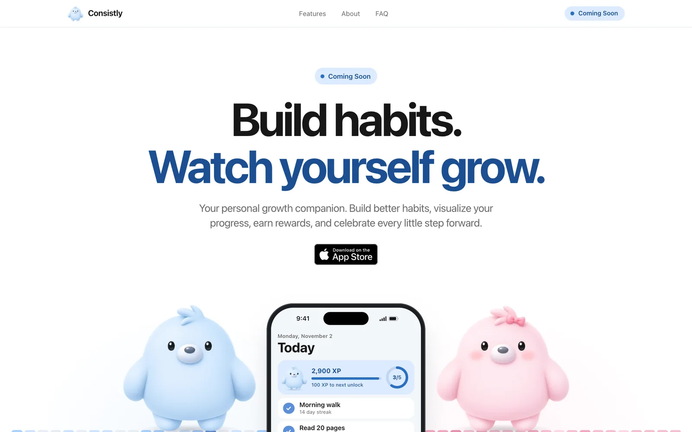
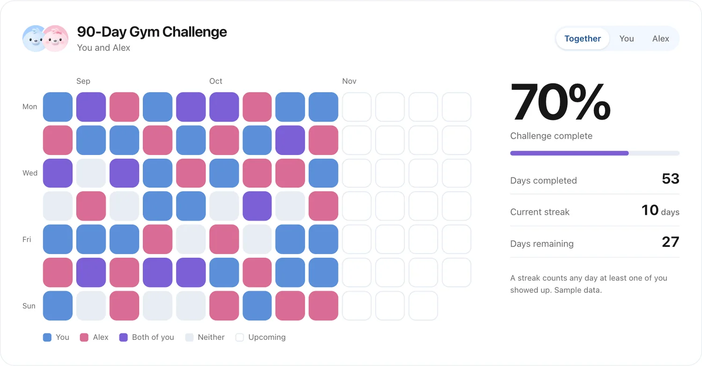
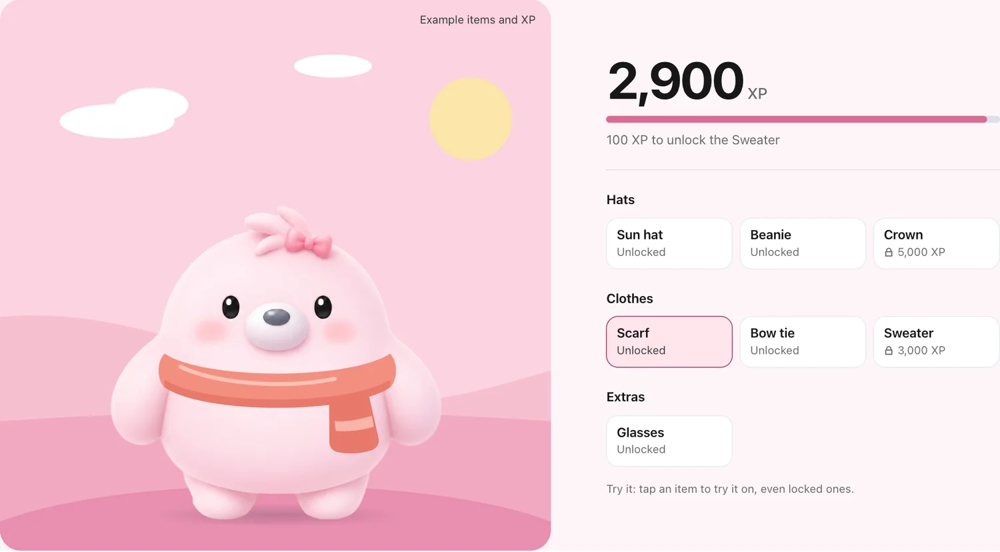
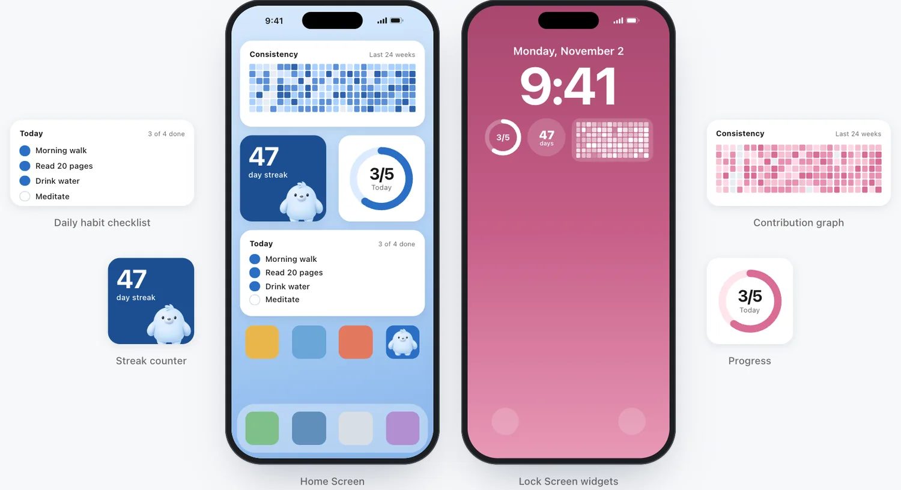
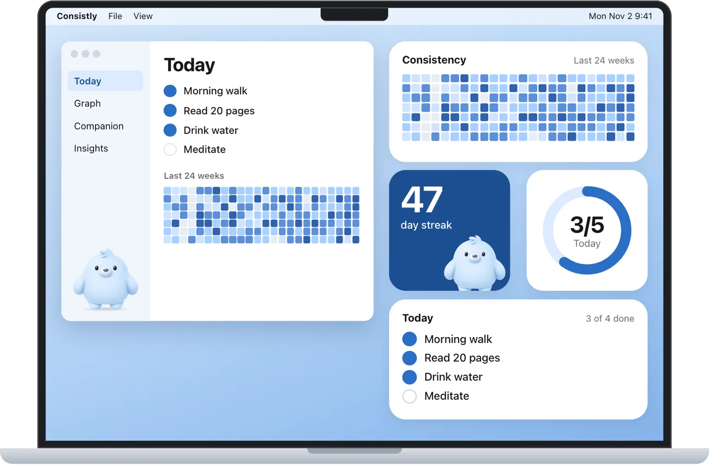

<p align="center">
  
  
</p>

<h1 align="center">Consistly</h1>

<p align="center">
  <b>Build habits. Watch yourself grow.</b><br>
  A personal growth companion for iPhone and Mac. Coming soon.
</p>

<p align="center">
  <a href="https://www.consistly.info"><b>www.consistly.info</b></a>
</p>

<p align="center">
  <a href="https://github.com/Consistly-info/web/actions/workflows/ci.yml"></a>
  
  
</p>

<p align="center">
  
</p>

This repository holds the official Consistly website, a fast static page that showcases the upcoming app. The app itself is not in this repository.

## Upcoming features

Consistly is still in development. Everything below is planned, and details may change before release.

| Feature                  | What it does                                                                        |
| ------------------------ | ----------------------------------------------------------------------------------- |
| **Habit tracking**       | Custom habits, daily and weekly goals, scheduling, streaks, and completion progress |
| **Contribution graphs**  | A GitHub-inspired picture of your year, for all your habits or just one             |
| **Personal companions**  | A blue and a pink character to keep you company                                     |
| **XP and unlocks**       | Earn XP from your habits and unlock hats, clothes, and more for your companion      |
| **Rewards**              | Gems, achievement badges, milestones, and daily and weekly challenges               |
| **Social challenges**    | Challenge friends and track a habit together in a shared contribution graph         |
| **Widgets**              | Home Screen and Lock Screen widgets for your checklist, graph, streak, and progress |
| **Mac app**              | Consistly on your MacBook, with the same widgets on your desktop                    |
| **Personal insights**    | Completion stats, habit performance, monthly comparisons, and milestones            |
| **Privacy-first design** | A local-first approach, with no mandatory account intended for basic usage          |

Consistly will be released on the App Store soon.

## A look inside

The screens below are concept designs with sample data.

**Build habits together.** Shared graphs show who showed up, and when.



**Earn XP, unlock new looks.** Pick a companion and try on what you've earned.



**Always within reach.** Widgets for your iPhone and your Mac.



<p align="center">
  
</p>

## Tech stack

| Area       | Choice                                                                       |
| ---------- | ---------------------------------------------------------------------------- |
| Framework  | [Astro](https://astro.build), with static output                             |
| Language   | TypeScript, for the interactive demos and sample data                        |
| Styling    | Plain CSS with shared design tokens, and no UI framework                     |
| Fonts      | The system font on Apple devices, with self-hosted Inter elsewhere           |
| Mockups    | iPhone, MacBook, and widget screens built in HTML and CSS rather than images |
| Code style | Prettier and `astro check`                                                   |
| CI         | GitHub Actions                                                               |
| Backend    | None. There is no database, authentication, or tracking                      |

## Getting started

Requires Node 22.23.4 or newer. `.nvmrc` pins version 24.

```sh
npm ci
npm run dev      # Start at http://localhost:4321
```

| Command           | What it does                          |
| ----------------- | ------------------------------------- |
| `npm run dev`     | Start the development server          |
| `npm run build`   | Build the site into `dist/`           |
| `npm run preview` | Serve the production build            |
| `npm run lint`    | Run the Prettier check and type check |
| `npm run format`  | Apply Prettier                        |

## Project structure

```text
src/
  pages/index.astro       Page, in section order
  layouts/Base.astro      HTML shell and scroll reveal
  components/
    sections/             One file per page section
    challenges/           Social challenges graph, creator, leaderboard, feed, rewards
    screens/              iPhone screen mockups
    AppStoreBadge.astro   App Store badge
    IPhone.astro          iPhone frame
    MacBook.astro         MacBook mockup with the Mac app and widgets
    Widget.astro          iOS widget mockups
    Heat.astro            Static contribution graph
    Mascot.astro          The companions and their accessories
  assets/mascot/          Companion images
  lib/
    challenge.ts          Sample data for social challenges
    sample.ts             Sample data for every other graph and chart
  styles/global.css       Design tokens and base styles
docs/images/              Screenshots used in this README
```

## Design notes

**Color.** Blue and pink belong to the two companions and live as tokens in `src/styles/global.css`. Set `data-theme="pink"` on a section to switch its accents. Sections are blue by default, and both colors appear together only where both companions do, such as shared graphs. The mascot images are never tinted.

**Mascots.** `src/assets/mascot/` holds both companions as transparent WebP files at 240, 480, and 960px, cut out with the same crop. Every appearance goes through `src/components/Mascot.astro`, and `character="pink"` shows the pink one. Accessories are an SVG layer in the same 960px coordinate system, with the feet at about 97% of the height.

## CI and deployment

`.github/workflows/ci.yml` runs on pull requests and pushes to `main`. It installs dependencies, runs lint and type checks, and builds the site. A failure in any step fails the workflow.

Deployment to GitHub Pages is included but **turned off**, because GitHub does not offer Pages for private repositories on the Free plan. To turn it on:

1. Make the repository public, or upgrade the organization's plan.
2. In **Settings > Pages**, set **Source** to **GitHub Actions**.
3. In **Settings > Secrets and variables > Actions > Variables**, add `DEPLOY_PAGES` with the value `true`.
4. Re-run the workflow or push to `main`.

To use the custom domain, set `www.consistly.info` under **Settings > Pages > Custom domain** and point DNS at GitHub. The workflow picks up the new base path by itself.

The output is plain static files, so any static host also works. Use `npm run build` as the build command and `dist` as the output directory.

| Variable               | Default                      | Purpose                                                 |
| ---------------------- | ---------------------------- | ------------------------------------------------------- |
| `BASE_PATH`            | `/`                          | Path the site is served from                            |
| `SITE_URL`             | `https://www.consistly.info` | Site origin used by the Astro config                    |
| `PUBLIC_APP_STORE_URL` | Not set                      | App Store listing. Turns the badge into a link when set |

## Credits

The App Store badge is adapted from [Untitled UI](https://github.com/untitleduico/react), which is MIT licensed.
